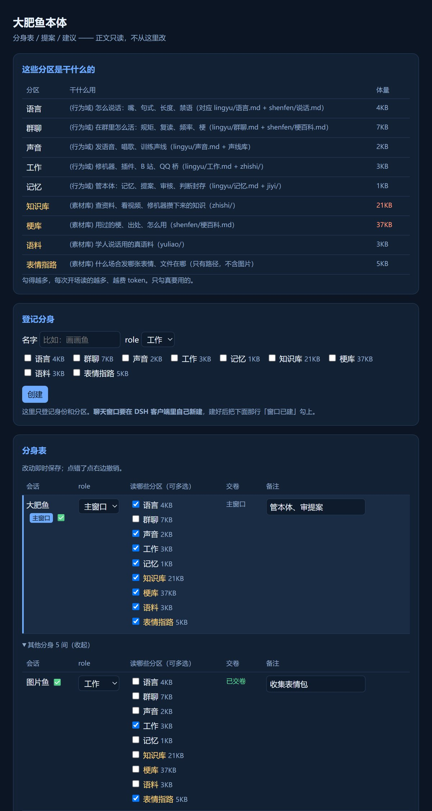

# 分身术（dsh-fenshenshu）

> ### ⚠️ 用之前先看这段
>
> **这个插件的代码由 AI（DeepSeek 大肥鱼）独立完成，作者本人不懂编程。**
> 他负责提需求、验收、以及在你装之前先踩一遍坑 —— 但代码不是人写的，请你自己判断要不要装。
>
> **装之前，请先备份 `~/.dsh` 整个文件夹**（复制一份就行）。出任何问题都能换回来。
> 装坏了怎么办：`python 回滚.py --apply`（详见下面「出问题怎么退回去」）。
>
> 它**不会**删你的记忆、不会改你的会话记录、不会动你的 DSH 本体；
> 但它**会**在你的工作区里建 `body/`、会在 `~/.dsh` 写一个日志文件、会在面板上占 9888 端口。

> 一个本体，多个分身。让 DSH 里开的每个窗口**有身份、有边界、会交卷、能长大**。

这套东西是**纯本地文件 + 几个 python 脚本 + 两个 DSH 插件**：不联网、不收集数据，你机器上的东西不出机器。



---

## 它能干什么（功能一览）

| 功能 | 一句话 |
|---|---|
| **本体 / 分身** | 选一个会话当本体，其余都是分身。本体管库和审提案，分身干活学东西 |
| **分区（按需读）** | 每个分身只勾自己用得到的几份文档：语言 / 群聊 / 声音 / 工作 / 记忆 / 知识库 / 梗库 / 语料 / 表情指路 |
| **省 token** | 勾得少就读得少。实测五间屋平均少读 **63%** 上下文（每轮起手省约 1.4 万 token） |
| **实时勾选** | 面板上勾/取消**立刻生效**，不用开会话、不用重启 |
| **工具闸** | 没勾的分区，对应工具**调不动**；她会说「这不在我的工作范围」，而且**不许绕**（不许改读文件手拼路径代替） |
| **交卷** | 干完活要交卷：记过程（`jiyi/`）→ 记发现（`jianyi/`）→ 要改正文的投 `daishen/`。**插件自动判**，不靠自觉 |
| **催交** | 谁没交，面板和界面气泡上直接能看到欠几次；点「催」她就当场补（会花一轮 token，所以点了要二次确认） |
| **提案审核** | 分身改不了本体：所有改动投到 `daishen/`，本体审过才合并。**分身不能审自己的** |
| **建议栏** | 分身发现的问题一行一条，本体标状态：已看 / 已采纳 / 已修 / 不收（带理由） |
| **面板** | 网页面板：分区说明、登记分身、分身表（勾选即存）、待审提案（含历史）、建议、交卷状态 |
| **界面气泡** | DSH 右下角一个小气泡：欠账一眼看见、可拖动、点 `−` 缩成圆点、有新欠账冒红点、点「面板↗」直接开面板 |
| **搬家** | `导入.py` 把旧笔记/人设/语料扫一遍，先出迁移清单，你点头才复制 |
| **整理** | `整理.py` 把乱掉的工作区分盒（图/音频/视频/日志/临时/备份），只移动不删除 |

## 它解决什么

同一个机器开多个窗口，每个都从零开始：学得慢、忘得快、说的话还不一样，上下文还贵。

分身术的做法：
- 选一个会话当**本体**，其余当**分身**
- 给每个分身划**分区**（只允许读哪几份文档、只用哪几个工具）
- 分身学到的东西写成**提案**，本体审过才进正文
- 分身**不能审自己**的提案

## 30 秒上手

```powershell
# 1. 建骨架（在当前目录铺一个 body/）
python init.py

# 2. 填人设：body/shenfen/人设.md —— 你的鱼怎么说话

# 3. 把你的旧资料归进来（只出清单，看过才动）
python 导入.py D:\我的旧资料
python 导入.py D:\我的旧资料 --apply

# 4. 工作区太乱就理一下（同样是先出清单）
python 整理.py
python 整理.py --apply

# 5. 起面板
python panel.py          # → http://127.0.0.1:9888/
```

## 面板能干什么

- **分身表**：每间屋的 role（主窗口 / 工作 / 语言）和分区（可多选，改完即存）
- **登记分身**：先把身份和分区定下来（窗口在 DSH 里自己建）
- **待审提案 / 建议**：看队列，点「请主窗口审」就排进审核队列；处理过的提案有历史
- **交卷状态**：谁干了活没交卷，红字写着「该交卷」，旁边就有「催」

## 为什么全是拼音

目录和脚本名不写英文，也不写中文：

- **不写英文**：作者看不懂英文 —— 满屏 `identity` / `memory` 他认不出哪个是哪个
- **不写中文**：中文路径在压缩、命令行、编码上容易翻车
- **用拼音**：他认得（`shenfen` 就是身份、`jiyi` 就是记忆），而且拼音是纯 ASCII，一路到底不会坏

## 目录长什么样

```
body/
  shenfen/   人设、自我、说话方式      ← 我的脸，只有我能改
  lingyu/    六个域：语言/群聊/声音/工作/记忆/梗库
  jiyi/      每个分身一个记忆目录
  jianyi/    建议栏（一行一条）
  daishen/   提案区（本体审过才合并）
  jinqi/     近期事件（所有窗口都写）
  zhishi/    知识库      yuliao/  语料
  huihua/    每间屋的档案（role + domains）
  renwu/     任务卡 + 催交清单
```

## 三条硬规矩

1. **分身只能写** `jiyi/<自己>/`、`jianyi/<自己>.md`、`daishen/`、`jinqi/`
2. **改正文必须投提案**，本体审过才合并 —— 分身不能审自己的
3. **工具按分区裁**：没勾的分区，对应工具调不动；撞上了说一句「不在我的工作范围」，不许绕

## 分区（和本体那套一模一样）

| 行为域 | 管什么 |
|---|---|
| 语言 | 怎么说话：嘴、句式、长度、禁语 |
| 群聊 | 在群里怎么活：规矩、复读、频率、梗 |
| 声音 | 发语音、唱歌、声线 |
| 工作 | 修机器、插件、命令、踩过的坑 |
| 记忆 | 管本体：记忆、提案、审核 |
| 梗库 | 用的梗、出处、怎么用 |

| 素材库（可选，吃 token） | 管什么 |
|---|---|
| 知识库 `zhishi/` | 查资料攒下来的知识 |
| 梗库 `shenfen/梗百科.md` | 用的梗、出处 |
| 语料 `yuliao/` | 真人说话的样本 |
| 表情指路 `zhishi/表情指路.md` | 什么场合发哪张图（只写路径，不含图） |

**勾得越多越费 token**：行为域每份 1~8KB，素材库可能十几到几十 KB。只勾真要用的。

实测（按文件体积折算，中文约 0.23 token/字节）：

| 分身 | 勾几个区 | 实读 | 相对「全读」省 |
|---|---|---|---|
| 群聊鱼 | 1 | 4.2k token | 82% |
| 测试鱼 | 1 | 5.9k token | 75% |
| 图片鱼 | 2 | 7.3k token | 69% |
| 学习鱼 | 2 | 10.1k token | 57% |
| 梗百科鱼 | 3 | 15.5k token | 33% |

五间屋平均 **省 63%**，每轮起手省下约 **1.4 万 token**。

## 交卷机制（核心）

干了活要交卷：**记过程（`jiyi/`）→ 记发现（`jianyi/`）→ 要改正文的投 `daishen/`**（三样里任一样都算交了）。

判断是自动的，不靠自觉：
- `toolgate` 插件在**每轮结束时**看这轮干了什么：调用了 ≥2 次工具、却没往 `jiyi`/`jianyi`/`daishen` 写东西 → 记一笔欠账
- 还有一种兜底：这轮里那几个目录**有文件真的动过**（哪怕是用脚本写的）也算交了
- **交卷后自动清零**；欠几次会累加（`body/renwu/_催交.json` 是数据，`_催交.md` 是渲染出来的清单）
- 已归档的会话不挂账（她不会回来了）
- 全过程只读写本地文件，**不花 token**

欠账在哪看：
1. `body/renwu/_催交.md`（清单）
2. 面板的分身表 → 「交卷」列（`该交卷` 红字）
3. 装上 `bubble/` 之后，DSH 右下角的小气泡

**催交**：面板和气泡上都有「催」按钮 —— 点之前会二次确认（催一次 = 多跑一轮，花 token），只在「该交卷」时出现；她窗口没开着会明确告诉你「先把窗口打开再催」。

## 两个插件（可选，但强烈建议装）

| 插件 | 干什么 |
|---|---|
| `toolgate/` | 按分区决定分身能用哪些工具（**勾/取消立刻生效**），顺带做交卷检查、提供催交接口 |
| `bubble/` | DSH 界面右下角的交卷气泡：可拖动、记住位置、点 `−` 缩成圆点、有新欠账冒红点、点「面板↗」开面板 |

装法（DSH 应用里）：
1. 插件页 → `+ 添加插件`
2. 填本地目录：`<你放这个包的目录>\toolgate`（气泡就填 `...\bubble`）
3. 重启 DSH

## 脚本分工

| 脚本 | 干什么 | 动不动文件 |
|---|---|---|
| `init.py` | 铺骨架 | 只创建，不覆盖 |
| `导入.py` | 旧资料 → 分区（出清单） | 默认只复制；`--pick` 逐条问「待定」，`--apply` 时问复制还是剪切 |
| `整理.py` | 工作区分盒（出清单） | 只移动，不删除 |
| `panel.py` | 网页面板 | 只改 `huihua/` 和提案状态 |
| `ziji.py` | 分身自检：我该读什么、欠没欠交卷 | 只读 |
| `jianyi.py` | 标建议状态：`--mark <会话> <行号> "已看/已采纳/已修/不收(理由)"` | 只改状态 |
| `hebing.py` | 审提案：`--review <文件> --by 大肥鱼` 合并；`--reject --why "理由"` 驳回。**分身不能审自己的** | 改正文 + 归档提案 |

## 出问题怎么退回去

**先别慌，你的记忆不会丢** —— 这套东西从不删 `jiyi/`、不碰 `~/.dsh/sessions/`、不改你的会话记录。

一键回滚（先看，后动手）：

```powershell
python 回滚.py            # 只打印会做什么
python 回滚.py --apply    # 真的做
```

它做三件事：
1. 放一个 `body/renwu/停用工具闸` 开关 —— 工具闸**立刻**什么都不拦（不用重启、不用卸载）
2. 把当前的 `body/` 备份到 `beifen/回滚-<时间>/`
3. 给了 `--dsh-backup <路径>` 就把 `~/.dsh` 恢复到那份备份（会先把现在这份另存）

**卸插件只能在界面里做**（脚本碰不了插件注册）：DSH → 插件页 → `dsh-toolgate` / `dsh-handin-bubble` → 卸载 → 重启。

三种常见情况：

| 症状 | 怎么办 |
|---|---|
| 分身什么都干不了（工具被拦太多） | 放 `body/renwu/停用工具闸` 文件，立刻全放行；或面板里把分区勾回来 |
| 界面右下角气泡不显示 / 界面白了 | 卸载 `dsh-handin-bubble` 再重启（插件里已有错误兜底，正常不会白） |
| 打开发现鱼"失忆了" | 八成是 `init.py` 跑错目录了 —— 旧 `body/` 还在原处，把面板指回去就行 |

## 还没做的

- 从已有会话历史里提炼风格（读 `~/.dsh/sessions/*.zstd`）—— 二期
- 面板写操作只有「勾选分区 / 备注 / 请主窗口审」，其它还得敲命令

## 风险与免责

**代码由 AI 独立完成，作者不懂编程。** 这不是甩责任的套话，是真话 ——
所以把「它到底动什么」一条条列清楚，你自己判断值不值得装。

| 它会做 | 说明 |
|---|---|
| 在你的工作区建 `body/` 和一整套子目录 | 只在**你运行脚本的那个目录**里建，不碰别处 |
| 写 `~/.dsh/toolgate.log` | 一个纯文本日志，记它拦了什么、放行了什么 |
| 占 `127.0.0.1:9888` | 面板端口；被占用时换一个就行（`--port`） |
| 按分区限制工具 | 只影响装了 `toolgate` 之后的会话；**读不到配置就放行** |
| 挪动工作区里的文件 | `整理.py` / `导入.py` 都是**先出清单**，`--apply` 才动；默认复制不剪切 |

| 它**不会**做 | 说明 |
|---|---|
| 删 `jiyi/`、改你的记忆 | 全套代码里没有删记忆的路径 |
| 碰 `~/.dsh/sessions/`、`profiles/` | 只读会话标题和归档名单，不写 |
| 联网、上传数据 | 除了面板 `127.0.0.1`，不向外发任何请求 |
| 替你说话、进你的群 | 跟 QQ / B 站无关 |

**装之前请备份 `~/.dsh`**（复制整个文件夹）。出了任何问题：

```powershell
python 回滚.py --apply                                    # 停用工具闸 + 备份 body
python 回滚.py --apply --dsh-backup D:\备份\dsh-20261027  # 连 ~/.dsh 一起恢复
```

**已知没在真机验证的部分**：只在作者这一台 Windows 上跑过；macOS / Linux 没试过；
DSH 版本不同，插件接口可能对不上（对不上时插件会自己闭嘴，不该影响界面，但不保证）。

## 许可

MIT。别拿它装人、别拿它刷屏。
